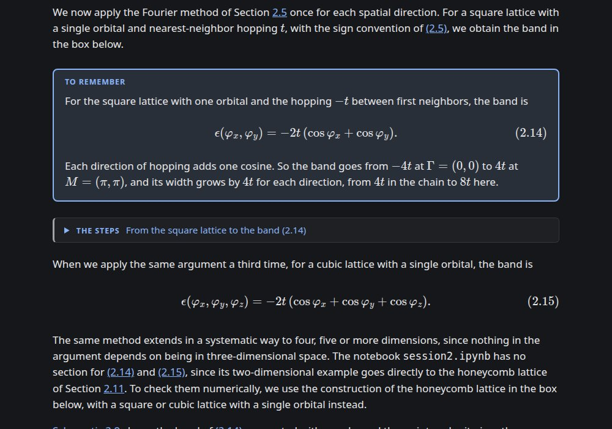
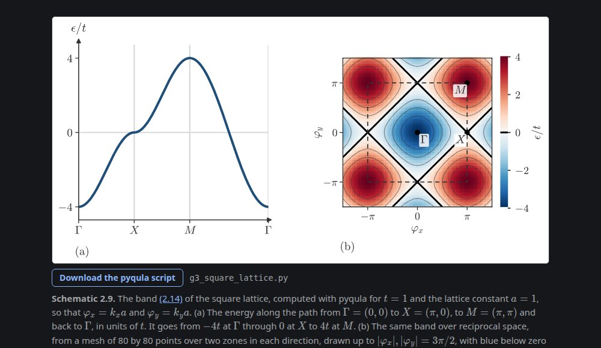
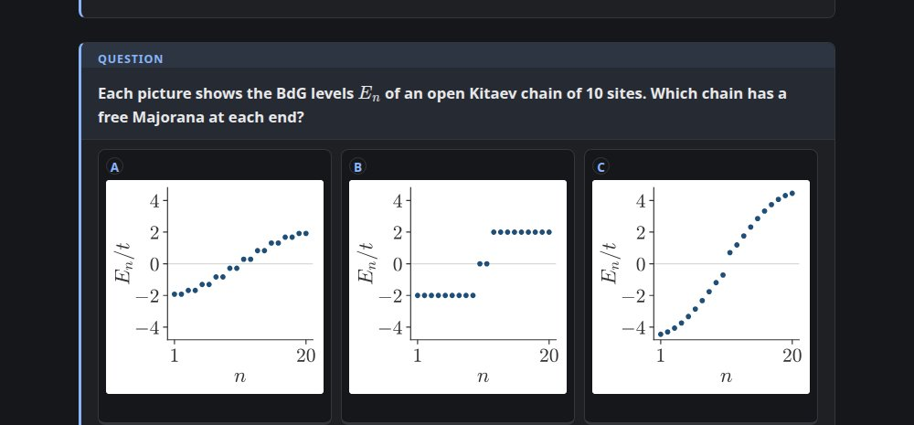
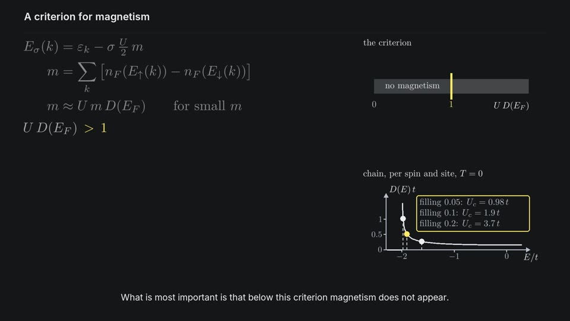
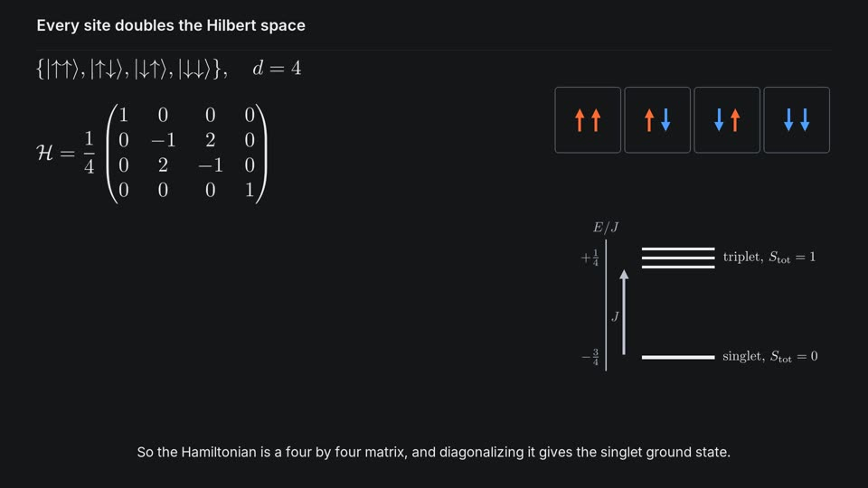
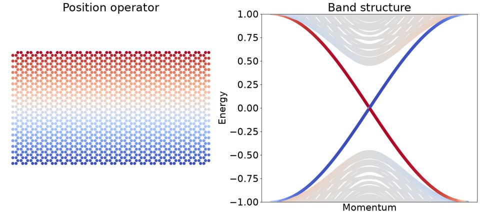
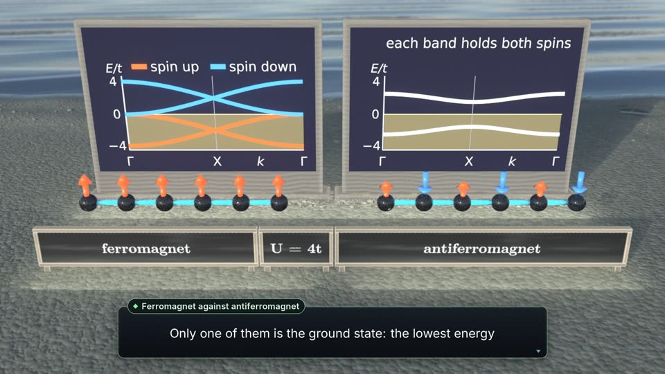
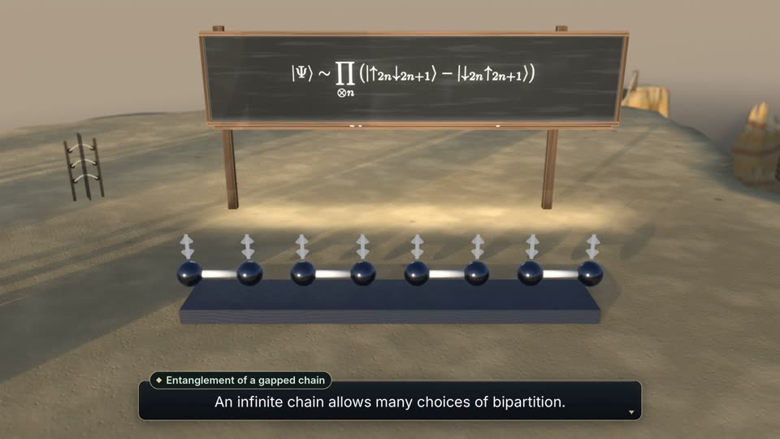
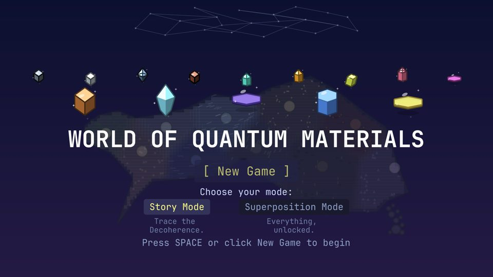
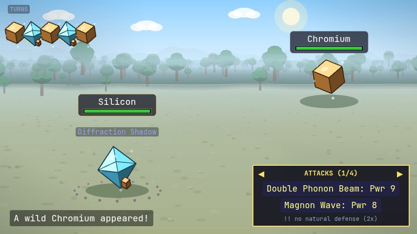

# Advanced Quantum Materials 2027

Teaching material for the course Advanced Quantum Materials at Aalto University, 2027.

## How to follow the course

The course has three central parts, the web notes, the video lectures and the Jupyter notebooks. For each session,
we suggest to first watch the video lecture, then go through the web notes to understand the details, and finally
work with the notebook of the session.

| Session | Video lecture | Web notes | Notebook |
|---|---|---|---|
| 1. Second quantization, mean field and spontaneous symmetry breaking | [watch](https://joselado.github.io/Advanced_Quantum_Materials_2027/lectures/session1.html) | [read](https://joselado.github.io/Advanced_Quantum_Materials_2027/notes/session1/index.html) | [GitHub](https://github.com/joselado/Advanced_Quantum_Materials_2027/blob/main/jupyter-notebooks/session1.ipynb), [Colab](https://colab.research.google.com/github/joselado/Advanced_Quantum_Materials_2027/blob/main/jupyter-notebooks/session1.ipynb) |
| 2. Symmetries, band structure theory and effective models | [watch](https://joselado.github.io/Advanced_Quantum_Materials_2027/lectures/session2.html) | [read](https://joselado.github.io/Advanced_Quantum_Materials_2027/notes/session2/index.html) | [GitHub](https://github.com/joselado/Advanced_Quantum_Materials_2027/blob/main/jupyter-notebooks/session2.ipynb), [Colab](https://colab.research.google.com/github/joselado/Advanced_Quantum_Materials_2027/blob/main/jupyter-notebooks/session2.ipynb) |
| 3. Topological band structure theory | [watch](https://joselado.github.io/Advanced_Quantum_Materials_2027/lectures/session3.html) | [read](https://joselado.github.io/Advanced_Quantum_Materials_2027/notes/session3/index.html) | [GitHub](https://github.com/joselado/Advanced_Quantum_Materials_2027/blob/main/jupyter-notebooks/session3.ipynb), [Colab](https://colab.research.google.com/github/joselado/Advanced_Quantum_Materials_2027/blob/main/jupyter-notebooks/session3.ipynb) |
| 4. Electrons in magnetic fields, the quantum Hall effect and Landau levels | [watch](https://joselado.github.io/Advanced_Quantum_Materials_2027/lectures/session4.html) | [read](https://joselado.github.io/Advanced_Quantum_Materials_2027/notes/session4/index.html) | [GitHub](https://github.com/joselado/Advanced_Quantum_Materials_2027/blob/main/jupyter-notebooks/session4.ipynb), [Colab](https://colab.research.google.com/github/joselado/Advanced_Quantum_Materials_2027/blob/main/jupyter-notebooks/session4.ipynb) |
| 5. Superconductivity, Nambu representation and Majorana physics | [watch](https://joselado.github.io/Advanced_Quantum_Materials_2027/lectures/session5.html) | [read](https://joselado.github.io/Advanced_Quantum_Materials_2027/notes/session5/index.html) | [GitHub](https://github.com/joselado/Advanced_Quantum_Materials_2027/blob/main/jupyter-notebooks/session5.ipynb), [Colab](https://colab.research.google.com/github/joselado/Advanced_Quantum_Materials_2027/blob/main/jupyter-notebooks/session5.ipynb) |
| 6. Classical magnetism and magnons | [watch](https://joselado.github.io/Advanced_Quantum_Materials_2027/lectures/session6.html) | [read](https://joselado.github.io/Advanced_Quantum_Materials_2027/notes/session6/index.html) | [GitHub](https://github.com/joselado/Advanced_Quantum_Materials_2027/blob/main/jupyter-notebooks/session6.ipynb), [Colab](https://colab.research.google.com/github/joselado/Advanced_Quantum_Materials_2027/blob/main/jupyter-notebooks/session6.ipynb) |
| 7. Quantum entanglement and tensor networks | [watch](https://joselado.github.io/Advanced_Quantum_Materials_2027/lectures/session7.html) | [read](https://joselado.github.io/Advanced_Quantum_Materials_2027/notes/session7/index.html) | [GitHub](https://github.com/joselado/Advanced_Quantum_Materials_2027/blob/main/jupyter-notebooks/session7.ipynb), [Colab](https://colab.research.google.com/github/joselado/Advanced_Quantum_Materials_2027/blob/main/jupyter-notebooks/session7.ipynb) |
| 8. Quantum magnetism, spinons and Kondo physics | [watch](https://joselado.github.io/Advanced_Quantum_Materials_2027/lectures/session8.html) | [read](https://joselado.github.io/Advanced_Quantum_Materials_2027/notes/session8/index.html) | [GitHub](https://github.com/joselado/Advanced_Quantum_Materials_2027/blob/main/jupyter-notebooks/session8.ipynb), [Colab](https://colab.research.google.com/github/joselado/Advanced_Quantum_Materials_2027/blob/main/jupyter-notebooks/session8.ipynb) |
| 9. Excitations and defects in quantum materials | [watch](https://joselado.github.io/Advanced_Quantum_Materials_2027/lectures/session9.html) | [read](https://joselado.github.io/Advanced_Quantum_Materials_2027/notes/session9/index.html) | [GitHub](https://github.com/joselado/Advanced_Quantum_Materials_2027/blob/main/jupyter-notebooks/session9.ipynb), [Colab](https://colab.research.google.com/github/joselado/Advanced_Quantum_Materials_2027/blob/main/jupyter-notebooks/session9.ipynb) |
| 10. Machine learning quantum materials | [watch](https://joselado.github.io/Advanced_Quantum_Materials_2027/lectures/session10.html) | [read](https://joselado.github.io/Advanced_Quantum_Materials_2027/notes/session10/index.html) | no notebook yet |

## Web notes

The [web notes](https://joselado.github.io/Advanced_Quantum_Materials_2027/notes/index.html) are the main material
of the course, one page per section. Each page opens with the question that it answers, and its main results are in
boxes. A page has the explanations, the derivations in folded steps, short problems with their solutions, and quizzes
that can be read alone. The simulations are small pyqula scripts that you download next to each plot, and some pages
have widgets that run in the browser. A box "In the lab" ties a result to a real measurement, with its source.
Sessions 1 to 5 have this full shape already, and the other sessions follow.

<p>


</p>
<p>

</p>

## Video lectures

The [video lectures](https://joselado.github.io/Advanced_Quantum_Materials_2027/#lectures) follow the original
recordings of the course. Each step of a calculation is written when it is said, next to a schematic or a plot
computed with the codes of the course. The video files are in the
[lectures release](https://github.com/joselado/Advanced_Quantum_Materials_2027/releases/tag/lectures).

<p>


</p>

## Jupyter notebooks

The notebooks of `jupyter-notebooks` compute the models of each session with
[pyqula](https://github.com/joselado/pyqula), such as band structures, topological invariants, mean-field orders and
superconductors. They open in Colab with no install, or run on a laptop after the install below.
[`minimal_test.ipynb`](https://github.com/joselado/Advanced_Quantum_Materials_2027/blob/main/jupyter-notebooks/minimal_test.ipynb)
checks that the installation works.

<p>

</p>

```bash
pip install --upgrade pyqula
```

Sessions 7 and 8 also use [dmrgpy](https://github.com/joselado/dmrgpy). Recordings of the solutions of the notebooks,
from the previous edition of the course, are on YouTube for
[session 1](https://youtu.be/EOhNyXA3rX8), [session 2](https://youtu.be/W_7ETh7WpGE),
[session 3](https://youtu.be/4WkBHhOfWwE) and [session 5](https://youtu.be/qZcwsdk6Y3U).

## Lecture notes as a PDF

For those who prefer a single document, the course is also written as conventional
[lecture notes in PDF](https://github.com/joselado/Advanced_Quantum_Materials_2027/blob/main/lecture_notes/main.pdf),
with the LaTeX sources in `lecture_notes/src`.

## Easter eggs

Two extras are hidden around the course. They are not needed to follow it, but whoever knows the physics will
recognize it everywhere in them.

The [landscape lectures](https://joselado.github.io/Advanced_Quantum_Materials_2027/#landscape) are artistic films of
the same lectures, with the same voice. We travel through 3D worlds, one per session, and the models of the session
are built into each world. The video files are in the
[films release](https://github.com/joselado/Advanced_Quantum_Materials_2027/releases/tag/films).

<p>


</p>

[World of Quantum Materials](https://joselado.github.io/world_of_quantum_materials/) is a role-playing game that runs
in the browser, related to the course but not part of it. You start as silicon and walk ten worlds, one per topic of
the course. You fight real compounds with the quasiparticles that your own lattice can host, so winning means knowing
which phase you are facing.

<p>


</p>
